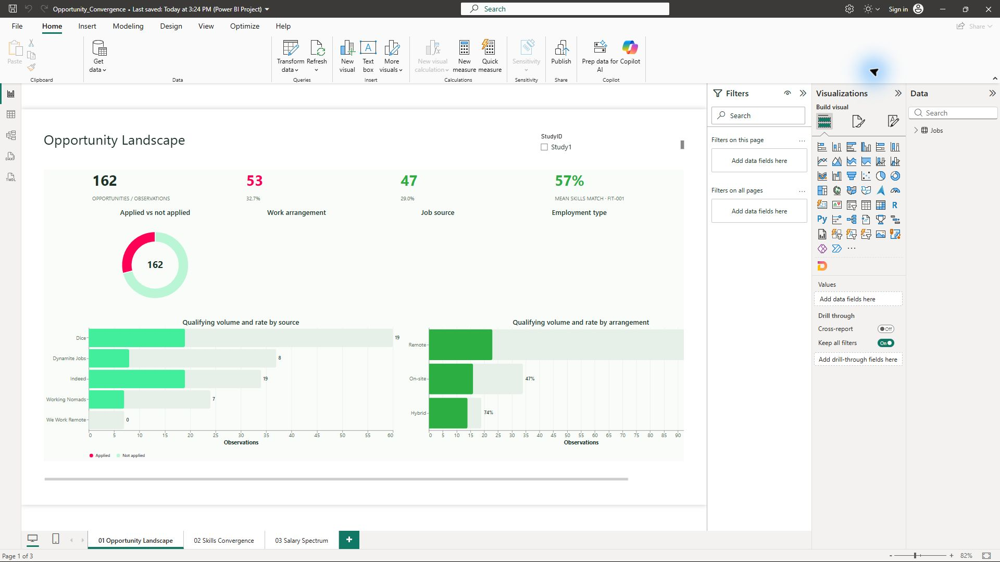
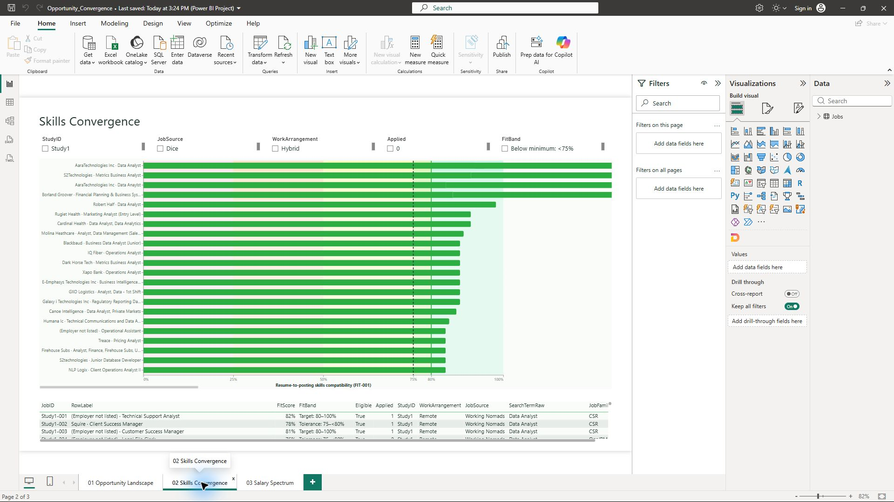
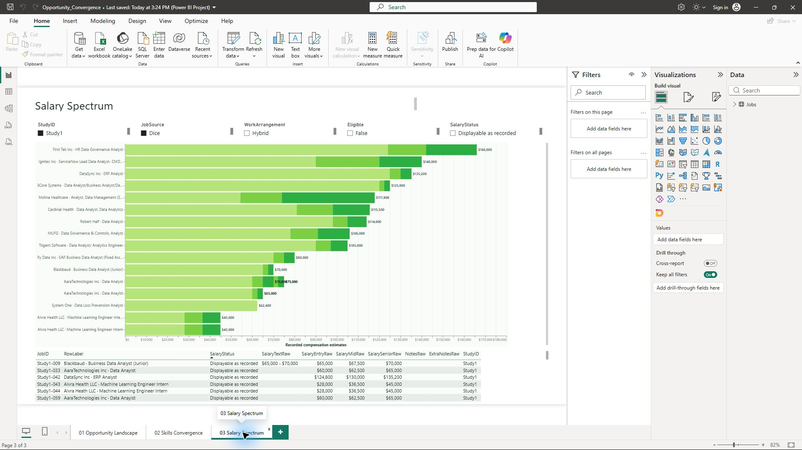

# Career Swap — Opportunity Convergence

A Power BI portfolio project analyzing **162 job opportunities** collected during a career transition. The study compares the opportunity landscape, professional skill alignment, and recorded salary ranges to support evidence-based career decisions.

## Objective and study scope

The project brings together two job-study spreadsheets into a three-page report. Its purpose is to make job opportunities easier to compare across role fit, compensation, and the available application details. The source workbooks are not published in this repository.

## Analysis and report pages

1. **Opportunity Landscape** — study-wide overview and opportunity filters.
2. **Skills Convergence** — comparisons of opportunities and recorded fit measures.
3. **Salary Spectrum** — recorded entry, mid, and senior compensation ranges, with salary-quality filters and detail rows.

## Tools and methods

- **Power BI Desktop** — interactive reporting and analysis.
- **Power Query** — importing and shaping the source workbook data.
- **DAX and TMDL** — semantic-model calculations and model definitions.
- **Deneb / Vega-Lite** — custom visual specifications.
- **PBIP / PBIR** — version-controlled Power BI project and report definitions.

## Dashboard screenshots

These are reference captures of the report in Power BI Desktop.

### Opportunity Landscape

### Skills Convergence

### Salary Spectrum

## Open the project

1. Install **Power BI Desktop**.
2. Download or clone this repository.
3. Open [`Opportunity_Convergence.pbip`](Opportunity-Convergence-162-Job-Study/Opportunity_Convergence.pbip) from the project folder.

The original source workbooks are **not included**. Refreshing the data on another computer requires both original spreadsheets:

- `Get a Job - Study 1-100.xlsx`
- `Get a Job - study 2 100-200.xlsx`

Set the Power Query `SourceRoot` parameter to their folder before refreshing. Existing model data and the ability to refresh are distinct: the screenshots document the report, but the published project is not independently reproducible without these workbooks.

## Repository contents

The complete Power BI project is in [`Opportunity-Convergence-162-Job-Study/`](Opportunity-Convergence-162-Job-Study/).

- [Project README](Opportunity-Convergence-162-Job-Study/README.md) — setup instructions and file explanations.
- [Power BI project entry point](Opportunity-Convergence-162-Job-Study/Opportunity_Convergence.pbip) — opens the report in Power BI Desktop.
- [Report definitions](Opportunity-Convergence-162-Job-Study/Opportunity_Convergence.Report/) — report pages, visuals, and theme.
- [Semantic model](Opportunity-Convergence-162-Job-Study/Opportunity_Convergence.SemanticModel/) — model definitions, DAX, and Power Query.
- [Visual specifications](Opportunity-Convergence-162-Job-Study/visual_specs/) — Deneb/Vega-Lite specifications.
- [Report-building script](Opportunity-Convergence-162-Job-Study/Build_Report_Definitions.ps1) — script for generating report visual definitions.
- [Dashboard screenshots](Opportunity-Convergence-162-Job-Study/screenshots/) — three report page captures.

## Reproducibility and data notes

The source material consists of job-study spreadsheets compiled from job opportunities. The published repository provides the Power BI project definition, report design, and screenshots, but not the two Excel workbooks used for refresh. Application details and salary figures reflect the recorded study data, rather than a live job-market feed.

The `SourceRoot` parameter uses a placeholder rather than an individual computer's file path. Local Power BI cache files are excluded from the repository.

## Project purpose

This project demonstrates the use of Power BI to structure an applied career-research dataset, compare opportunities, evaluate skills alignment, and communicate compensation data through interactive reporting.
